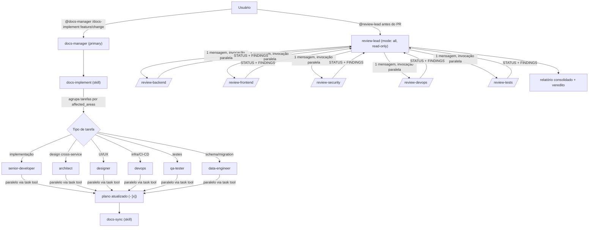
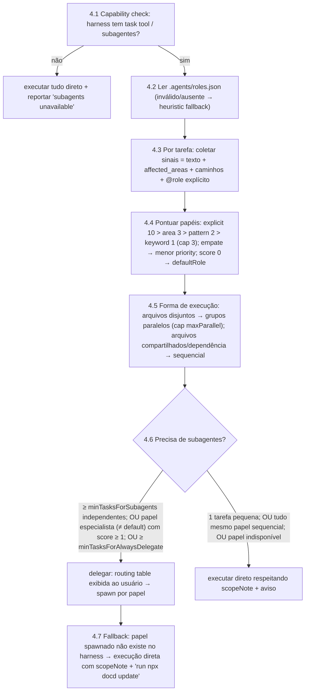

# Plano — Papéis Especializados de Agentes para Subagentes (Kilo/Kimi) com Detecção e Roteamento

## 1. Visão Geral

### Contexto

O `docd-cli` instala hoje apenas 1 agente (`docs-manager`) e 4 skills (`docs-plan`, `docs-implement`, `docs-sync`, `docs-generate-from-code`). Porém, os templates que já estão em produção **referenciam agentes de papel que o pacote não entrega**:

- [SKILL.md do docs-implement](file:///home/a/projects/linky/docd-cli/src/templates/skill/docs-implement/SKILL.md#L42-L46) delega tarefas para `programador-senior`, `arquiteto`, `designer` e `devops`;
- [docs-manager.md](file:///home/a/projects/linky/docd-cli/src/templates/agent/docs-manager.md#L225) direciona delegação para os mesmos papéis;
- O [README.md](file:///home/a/projects/linky/docd-cli/README.md#L60) admite explicitamente: *"Role-based agents are **not** included in this package."*

Na prática, esses papéis só existem na configuração global mantida manualmente pelo autor (`~/.config/kilo/kilo.jsonc` + `~/.config/kilo/agent/*.md`), em PT-BR. Qualquer outro projeto/máquina que rode `npx docd init` recebe templates que delegam a agentes inexistentes — a orquestração de subagentes quebra silenciosamente (o harness cai no agente genérico ou falha a invocação).

Harnesses com suporte a subagentes (Kilo Code, Kimi Code) descobrem agentes a partir de arquivos Markdown com frontmatter YAML em `.agents/agents/` (convenção compartilhada já suportada pelos dois providers) ou `~/.config/<harness>/agent/`. Isso torna viável empacotar os papéis como templates instaláveis pelo CLI, exatamente como os skills atuais.

### Objetivos

- Empacotar **13 templates de agentes** em `src/templates/agent/`: 7 papéis de execução (core) + 6 da suíte de review (coordenador + 5 especialistas read-only).
- **Detectar se subagentes são necessários e quais papéis usar** — novo registry de roteamento `.agents/roles.json` (dados) + fase de detecção determinística no `docs-implement` (algoritmo), com decisão explicável (tabela task → papel → motivo) e degradação graciosa.
- Instalação **por padrão** via `init`/`update`, sem nova flag, usando o pipeline de manifest/providers existente (descoberta recursiva já cobre novos arquivos — zero mudança de código no pipeline).
- Templates em **inglês**, nomes de agente em inglês, com atualização das referências de delegação em `docs-manager.md` e `docs-implement/SKILL.md`.
- Reviewers como `mode: subagent` + `hidden: true` + `permission: {edit: deny, write: deny}` — só acessíveis via `review-lead` (ou `@mention` direto para debug).
- Documentar o mapa de migração PT-BR → EN para usuários que já tinham os agentes globais.

### Fora de Escopo

- Lentes de review específicas de projeto (`review-go-backend`, `review-openapi`, `review-tenant-rls`, `review-permissions-auth`) — permanecem no repositório consumidor.
- Geração de config inline (`kilo.jsonc`) — apenas arquivos `.md`, que são a convenção portável entre harnesses.
- Gate por capacidade do provider (`supportsSubagents`) — ambos os providers atuais suportam subagentes; abstração nova é prematura.
- Novos comandos CLI ou flags — o pipeline existente resolve.
- Agent Manager (worktrees/sessões) — continua sendo mecanismo do harness, não do bundle.

## 2. Análise do Código Existente & Decisões de Design

### Pontos de Integração

| Arquivo | Impacto |
|---|---|
| `src/templates/agent/` | +13 novos `.md` (payload). A [descoberta recursiva do manifest](file:///home/a/projects/linky/docd-cli/src/manifest.ts#L31-L50) os pega automaticamente, incluindo extração de `version` do frontmatter. |
| `src/templates/roles.json` | **Novo** — registry de roteamento (fonte única de verdade dos gatilhos de cada papel). Sem frontmatter → `version: null`; o `update` detecta drift por diff de conteúdo ([`hasMeaningfulDiff`](file:///home/a/projects/linky/docd-cli/src/diff.ts)). [`getInstalledPath`](file:///home/a/projects/linky/docd-cli/src/providers/base.ts#L47-L48) cai no default → instala em `.agents/roles.json` (fora dos dirs de agentes/skills, ignorado pelo harness como agente). |
| [`getInstalledPath`](file:///home/a/projects/linky/docd-cli/src/providers/base.ts#L40-L42) | Sem mudança: `agent/<file>` → `<configDir>/<agentDirName>/<file>` = `.agents/agents/<file>` nos dois providers. |
| [`runInit`](file:///home/a/projects/linky/docd-cli/src/commands/init.ts#L57-L71) | Sem mudança: cria `agentDir` e instala todo o manifest. |
| [`runUpdate`](file:///home/a/projects/linky/docd-cli/src/commands/update.ts#L90-L99) | Sem mudança: arquivo ausente → instala; divergência de `version`/conteúdo → prompt/backup. |
| `src/templates/agent/docs-manager.md` | bump `1.3.0 → 1.4.0`; seção "When to delegate" passa a citar os nomes EN e o registry `roles.json`. |
| `src/templates/skill/docs-implement/SKILL.md` | bump `1.4.0 → 1.5.0`; **novo passo 4 (Detect subagent needs & routing)** e passo 5 (Distribute) passa a citar os nomes EN. |
| `README.md` | Remover a frase "not included"; adicionar tabela de papéis + seção de roteamento. |
| `tests/dogfood.test.ts` | Continua válidos — depois de editar templates, `npm run dev -- update --yes` sincroniza `.agents/`. |

### Trade-offs

| Decisão | Alternativa considerada | Justificativa da escolha |
|---|---|---|
| Nomes EN (`architect`, `senior-developer`) mantendo a semântica dos PT-BR | Manter nomes PT-BR dos templates | Usuário escolheu templates em inglês; consistência nome↔idioma evita agentes "bilíngues" inconsistentes. Custo: `docs-implement`/`docs-manager` precisam de bump de versão — barato, o fluxo de update já trata. |
| Instalação por padrão (manifest único) | Flag `--roles` + filtro por grupo no manifest | Zero código novo no pipeline (manifest/status/update funcionam de graça); usuários que não quiserem os papéis simplesmente não os usam — arquivos `.md` inertes sem subagente em uso. |
| Arquivos `.md` com frontmatter | Agentes inline no `kilo.jsonc` do usuário | `.md` é a convenção compartilhada kilo+kimi (`.agents/`), versionável pelo mecanismo de update/backups do CLI; inline exigiria gerar/mergear JSON por harness. |
| Reviewers `hidden: true` + read-only via `permission` | Reviewers visíveis e sem restrição | Espelha a config global já validada em produção: o coordenador (`review-lead`) é o único ponto de entrada, especialistas recebem arquivos e devolvem findings — `edit/write: deny` impede que um reviewer "conserte" código durante o review. |
| Papéis `mode: all` para implementadores | Todos como `subagent` | `mode: all` permite tanto uso direto como sessão principal (`docd` + seleção do papel) quanto spawn via `task` tool — mesmo comportamento da config global atual. |
| Registry de roteamento em JSON separado (`roles.json`) | `triggers` no frontmatter de cada agente `.md` | Fonte única de verdade sem risco de drift; frontmatter dos `.md` fica só com chaves que o harness reconhece (chaves desconhecidas podem ser rejeitadas/ignoradas por outros harnesses); JSON é validável por teste e inspecionável pelo orquestrador sem parsear 13 arquivos. |
| Detecção determinística por regras pontuadas (área > glob > keyword) | Deixar o LLM "escolher" o papel a cada execução | Best practice de agentes: regras determinísticas primeiro (explicável, auditável, barato, estável entre execuções); o julgamento do LLM fica como tie-breaker e para sinais ambíguos. |

> [!TIP]
> Fluxo proposto de orquestração (o mesmo de hoje, mas agora portável a qualquer projeto):



## 3. Especificação Técnica Detalhada

### 3.1 Estrutura de Arquivos (payload)

```text
src/templates/agent/
  docs-manager.md            # existente, bump 1.4.0
  architect.md               # novo
  senior-developer.md        # novo
  designer.md                # novo
  devops.md                  # novo
  qa-tester.md               # novo
  data-engineer.md           # novo
  tech-writer.md             # novo
  review-lead.md             # novo
  review-backend.md          # novo
  review-frontend.md         # novo
  review-security.md         # novo
  review-devops.md           # novo
  review-tests.md            # novo
```

Instalação resultante (kilo e kimi compartilham layout; `update` deduplica passos no mesmo `configDir`): `.agents/agents/<name>.md` (projeto) ou `~/.agents/agents/<name>.md` (`--global`).

### 3.2 Contrato de Frontmatter (todos os templates)

```yaml
---
name: <nome-do-agente>          # obrigatório, igual ao nome do arquivo
version: 1.0.0                  # obrigatório — mecanismo de update do manifest
description: <uma linha>        # obrigatório — aparece no catálogo de agentes do harness
mode: all | subagent            # all = sessão própria + subagente; subagent = só via task/@mention
hidden: true                    # somente nos review-* especialistas
temperature: 0.1 | 0.2          # 0.1 review; 0.2 execução
permission:                     # somente review-lead e review-*
  edit: deny
  write: deny
---
```

### 3.3 Catálogo de Papéis

| # | name | mode | hidden | temp | permissão | Responsabilidade | Origem do prompt |
|---|---|---|---|---|---|---|---|
| 1 | `architect` | all | não | 0.2 | — | Design de sistemas, APIs, modelos de dados, integrações, trade-offs; **não** implementa — orienta o `senior-developer`. | tradução EN de `arquiteto` |
| 2 | `senior-developer` | all | não | 0.2 | — | Implementação/refatoração/testes em qualquer subprojeto; executor padrão do `docs-implement`. | tradução EN de `programador-senior` |
| 3 | `designer` | all | não | 0.2 | — | UI/UX, design system, acessibilidade; não altera lógica de negócio. | tradução EN de `designer` |
| 4 | `devops` | all | não | 0.2 | — | Docker, CI/CD, IaC, secrets, observabilidade; não toca código de negócio. | tradução EN de `devops` |
| 5 | `qa-tester` | all | não | 0.1 | — | Desenho/execução de testes, cobertura, casos de regressão; escreve apenas código de teste. | novo |
| 6 | `data-engineer` | all | não | 0.1 | — | Schemas, migrations, queries, integridade/invariantes de dados. | novo |
| 7 | `tech-writer` | all | não | 0.2 | — | Docs técnicos, ADRs, changelogs; integrado ao layout DOCD (`config.docs`). | novo |
| 8 | `review-lead` | all | não | 0.1 | edit/write: deny | Coordenador de review: descobre escopo (`git status/diff`), roda verificação automatizada, delega aos 5 especialistas em **uma única mensagem paralela**, re-invoca em contradição (máx. 2 rodadas), sintetiza relatório com veredito LGTM / NEEDS CHANGES / DISCUSS. | port do `review-lead` global |
| 9 | `review-backend` | subagent | sim | 0.1 | edit/write: deny | API design, queries (N+1, soft-delete leak), invariantes, semântica de mutação, ciclo de deleção. | port do global |
| 10 | `review-frontend` | subagent | sim | 0.1 | edit/write: deny | Componentes, estado cliente, acessibilidade, performance de UI. | port do global |
| 11 | `review-security` | subagent | sim | 0.1 | edit/write: deny | Auth/sessão, cripto, injeção, secrets, permissões/isolamento multi-tenant. | port do global |
| 12 | `review-devops` | subagent | sim | 0.1 | edit/write: deny | Dockerfile, pipelines, IaC, configs de deploy, prontidão operacional. | port do global |
| 13 | `review-tests` | subagent | sim | 0.1 | edit/write: deny | Qualidade dos testes novos: cobertura real, asserts, casos de borda, testes que testam. | port do `~/.agents/agents/review-tests.md` |

### 3.4 Corpo dos Prompts (padrão por papel)

Papéis de execução (1–7), corpo em inglês com esta estrutura fixa:

```markdown
# <Role>
## Role
<1 parágrafo: especialidade e limites do papel.>
## Mandatory instruction
Before starting, read the `AGENTS.md` of the subproject you are working on.
If there are multiple subprojects, read all of them.
## Responsibilities
- <4–6 bullets específicos do papel>
## What NOT to do
- <5 bullets: não sair do escopo, não commitar, não escrever docs extensas não solicitadas, delegar fora da especialidade>
## Delegation
- <para onde encaminhar trabalho fora da especialidade>
```

Coordenador e especialistas de review mantêm o contrato já validado: especialistas respondem **exatamente** no formato abaixo e o `review-lead` nunca delega para fora dos 5:

```text
STATUS: PASS | CONCERNS | BLOCKING
FINDINGS:
- [Issue]: file:line — impact and suggested fix
POSITIVE NOTES:
- [what's done well]
```

### 3.5 Mudanças nos Templates Referenciadores

`docs-manager.md` (1.4.0) e `docs-implement/SKILL.md` (1.5.0) — única mudança de conteúdo, seção de delegação:

| Referência antiga (PT-BR) | Referência nova (EN) |
|---|---|
| `programador-senior` | `senior-developer` |
| `arquiteto` | `architect` |
| `designer` | `designer` (inalterado) |
| `devops` | `devops` (inalterado) |
| — | `qa-tester`, `data-engineer`, `tech-writer` (novos destinos no passo "Distribute tasks") |

### 3.6 Tratamento de Erros & Resiliência (comportamento em projetos "sujos")

- **Agente com mesmo nome em escopo global**: o harness resolve projeto > global; `docd update` faz backup em `.agents/.docd-backups/` antes de sobrescrever e o prompt interativo oferece manter/ver diff/abortar —customização local nunca é perdida silenciosamente.
- **Delegação para papel ausente** (projeto antigo, templates não atualizados): o `docs-implement` 1.5.0 deve instruir: se o subagente não existir no harness, executar a tarefa diretamente respeitando o escopo do papel, e sugerir `npx docd update`.
- **Harness sem suporte a `mode: subagent`** (futuro provider): arquivos continuam válidos como personas (`mode: all` é interpretado como agente comum); nenhum payload quebra o harness — é Markdown.
- **Registry `roles.json` ausente ou inválido** (projeto antigo, JSON corrompido pelo usuário): o `docs-implement` segue com roteamento heurístico (usa apenas os nomes de papel listados no próprio skill) e nunca falha a implementação por causa do registry.
- **Papel roteado não disponível no harness** (agente não instalado): fallback para execução direta respeitando o `scopeNote` do papel + aviso + sugestão de `npx docd update`.

## 3.7 Registry de Roteamento — `src/templates/roles.json` → `.agents/roles.json`

Fonte única de verdade para a detecção. O `docs-implement` (e qualquer orquestrador) lê este arquivo — nunca "adivinha" papéis. Schema:

```json
{
  "version": "1.0.0",
  "description": "DOCD role routing registry — consumed by docs-implement and any orchestrator to decide IF subagents are needed and WHICH role handles each task.",
  "selection": {
    "defaultRole": "senior-developer",
    "precedence": ["explicit", "affectedArea", "filePattern", "keyword"],
    "scores": { "explicit": 10, "affectedArea": 3, "filePattern": 2, "keyword": 1 },
    "maxKeywordScore": 3,
    "minTasksForSubagents": 2,
    "minTasksForAlwaysDelegate": 5,
    "maxParallel": 4
  },
  "roles": [
    {
      "name": "architect",
      "kind": "design",
      "routedBy": "docs-implement",
      "priority": 10,
      "affectedAreas": ["architecture", "api", "data-models", "integrations", "contracts"],
      "filePatterns": ["**/contracts/**", "**/openapi*", "**/*.schema.*", "**/proto/**"],
      "keywords": ["architecture", "contract", "schema design", "trade-off", "integration", "boundary", "microservice", "api design", "event", "queue"],
      "scopeNote": "Design decisions and contracts only; delegates implementation to senior-developer."
    }
  ]
}
```

Contrato dos campos:

| Campo | Significado |
|---|---|
| `name` | Deve existir como template em `agent/<name>.md` (validado por teste). |
| `kind` | `design` \| `implementation` \| `testing` \| `data` \| `docs` \| `infra` \| `review` — agrupa papéis para decisões de paralelismo. |
| `routedBy` | Quem pode spawnar o papel: `docs-implement` (papéis de execução) ou `review-lead` (especialistas de review — o orquestrador **nunca** os invoca direto). |
| `priority` | Tie-breaker: menor valor vence em empate de score (10 = mais específico). |
| `affectedAreas` | Match exato contra `affected_areas` do guia/da tarefa (score 3). |
| `filePatterns` | Globs comparados aos caminhos citados na tarefa/plano (score 2). |
| `keywords` | Substrings case-insensitive no texto da tarefa (score 1 cada, cap `maxKeywordScore`). |
| `scopeNote` | Injetado no prompt de fallback quando o papel não está instalado. |

## 3.8 Algoritmo de Detecção — novo passo 4 do `docs-implement`

Determinístico primeiro, LLM só como tie-breaker (explicável e estável entre execuções):



Critérios explícitos do 4.6 (quando **não** orquestrar — evita over-orchestration, custo de tokens e perda de contexto):

- 1 tarefa (ou 2 triviais do mesmo papel) → direto.
- Todas as tarefas tocam os mesmos arquivos → sequencial, um agente (ou direto).
- Apenas o `defaultRole` roteado e nenhuma dependência paralela → direto.
- Usuário pediu execução direta → direto.
- Papel roteado não existe no harness → fallback direto com aviso (nunca falha).

Saída obrigatória do passo 4 (transparência/auditabilidade) — tabela exibida antes de spawnar:

```text
| Task | Role | Match (explicit/area/pattern/keyword/default) | Mode (parallel-N/sequential) |
```

## 4. Plano de Tarefas por Fases

### Fase 1: Papéis de execução (core) e registry de roteamento

- [x] Criar `src/templates/roles.json` — registry da seção 3.7 com os 13 papéis (`routedBy: docs-implement` para execução, `review-lead` para especialistas).
- [x] Criar `src/templates/agent/architect.md`, `senior-developer.md`, `designer.md`, `devops.md` — tradução EN dos prompts globais, com frontmatter da seção 3.2.
- [x] Criar `src/templates/agent/qa-tester.md`, `data-engineer.md`, `tech-writer.md` — papéis novos seguindo o mesmo esqueleto da seção 3.4.

### Fase 2: Suíte de review

- [x] Criar `src/templates/agent/review-lead.md` — port do coordenador (escopo → verificação → delegação paralela dos 5 → loop de re-invocação → relatório), `permission: {edit: deny, write: deny}`.
- [x] Criar `review-backend.md`, `review-frontend.md`, `review-security.md`, `review-devops.md`, `review-tests.md` — `mode: subagent`, `hidden: true`, read-only, formato de saída da seção 3.4.

### Fase 3: Detecção, referências e versionamento

- [x] Atualizar `src/templates/skill/docs-implement/SKILL.md` (1.4.0 → 1.5.0): novo passo 4 "Detect subagent needs & routing" (algoritmo 3.8), passo 5 consumindo a routing table, nomes EN + novos papéis, instrução de fallback para papel ausente (seção 3.6) e recomendação de `@review-lead` no finish.
- [x] Atualizar `src/templates/agent/docs-manager.md` (1.3.0 → 1.4.0): nomes EN na seção "When to delegate" + referência ao registry `roles.json`.

### Fase 4: Testes, docs e dogfood

- [x] Novo `tests/agent-templates.test.ts`: todo `agent/*.md` tem frontmatter `name`==nome do arquivo, `mode`, `description`, `version`; todo `review-*` especialista tem `hidden: true` e `permission.edit|write === "deny"`; `roles.json` é JSON válido, todo `name` tem template correspondente, todo template de papel tem entrada no registry, `defaultRole` existe, `routedBy` só usa orquestradores conhecidos.
- [x] Atualizar `README.md`: remover frase "not included", tabela dos 13 papéis + seção "Subagent detection & routing" documentando `roles.json` e o algoritmo.
- [x] `npm run dev -- update --yes` para sincronizar `.agents/` (dogfood) e `npm test` verde (inclui `dogfood.test.ts`) — 54/54 testes passando, `test:types` limpo, smoke de `init`/`status` em `/tmp/kilo/docd-roles-test` OK.
- [x] Atualizar `docs/docd-cli/spec.md` + `changelog.md` (via `/docs-sync` após implementação).

## 5. Compatibilidade Reversa & Plano de Rollback

> [!WARNING]
> Projetos que já possuem os agentes PT-BR em config **global** passarão a ter os EN no **projeto**. Como `docs-implement`/`docs-manager` atualizados referenciam os EN, o comportamento muda de "agente global PT-BR" para "agente do projeto EN" após `docd update`. Se o projeto tiver customização local no global (permissões diferentes, por exemplo), ela deixa de valer para aquele projeto — revisar antes de aceitar o update.

- **Estratégia de Rollback**:
  1. `git revert` dos commits de template no docd-cli.
  2. Nos projetos consumidores: remover os 13 arquivos em `.agents/agents/` (o `update` **nunca apaga** arquivos fora do manifest — remoção é manual, o que é seguro) e restaurar `docs-manager.md`/`SKILL.md` do backup timestamped em `.agents/.docd-backups/`.
  3. `npx docd update --yes` para reconverger ao estado anterior do bundle.
- **Compatibilidade**:
  - Nada muda para quem não roda `docd update`: templates instalados continuam referenciando PT-BR e os globais continuam resolvendo.
  - `status` passa a listar os novos arquivos como "missing" até rodar `update` — mensagem orientada, sem ação destrutiva.
  - Kimi não precisa de tratamento especial: mesmo layout `.agents/`, e o dedup de provider idêntico em `update`/`status` evita instalação dupla.

## 6. Plano de Verificação

### Testes Automatizados

| Caso | Input | Output esperado | Comando |
|---|---|---|---|
| Dogfood sync | `.agents/` vs `src/templates/` | 0 drift (18 arquivos: 14 agent + 4 skill) | `npm test` |
| Frontmatter válido | cada `agent/*.md` | `name`==arquivo, `mode`, `description`, `version` presentes | `npx tsx --test tests/agent-templates.test.ts` |
| Reviewers read-only | cada `review-*` (exceto lead) | `hidden: true`, `permission.edit === "deny"`, `permission.write === "deny"` | idem |
| Registry consistente | `roles.json` | JSON válido; nomes ↔ templates bidirecionais; `defaultRole` existe; `routedBy` ∈ {`docs-implement`, `review-lead`}; precedência/scores íntegros | `npx tsx --test tests/agent-templates.test.ts` |
| Init completo | `npm run dev -- init --ide kilo` em `/tmp/kilo/docd-roles-test` | 13 papéis + docs-manager + 4 skills + `roles.json` instalados, `.docd.json` com bundle atual | script de smoke no smoke-dir |
| Status converge | após init no smoke-dir | todos os arquivos `up to date` | `npm run dev -- status` (cwd no smoke-dir) |

### Testes Manuais (Kilo Code, no projeto de smoke)

1. `npx docd init --ide kilo` no diretório de teste; abrir o Kilo no projeto.
2. No seletor de agentes: `architect`, `senior-developer`, `designer`, `devops`, `qa-tester`, `data-engineer`, `tech-writer`, `review-lead` visíveis (8); `review-*` especialistas **não** listados (hidden).
3. Task tool: `review-backend` aparece como subagente disponível; tentativa de `edit` por ele é **negada** pela permissão.
4. Rodar `@review-lead` sobre um diff com bug proposital (ex.: N+1 num service): verificar delegação paralela aos 5 e relatório final com veredito NEEDS CHANGES citando `file:line`.
5. `/docs-implement` de um plano com tarefas backend+UI+infra: verificar o passo 4 — capability check, routing table exibida (Task → Role → Match → Mode), distribuição para `senior-developer`/`designer`/`devops` e checkboxes atualizados.
6. Detecção de "não precisa": `/docs-implement` de um plano de 1 tarefa simples → execução direta sem spawn, sem routing table (apenas nota).
7. Fallback: renomear temporariamente `.agents/agents/architect.md` e rodar plano que roteia para `architect` → aviso + execução direta com o `scopeNote` do papel + sugestão de `npx docd update`.
